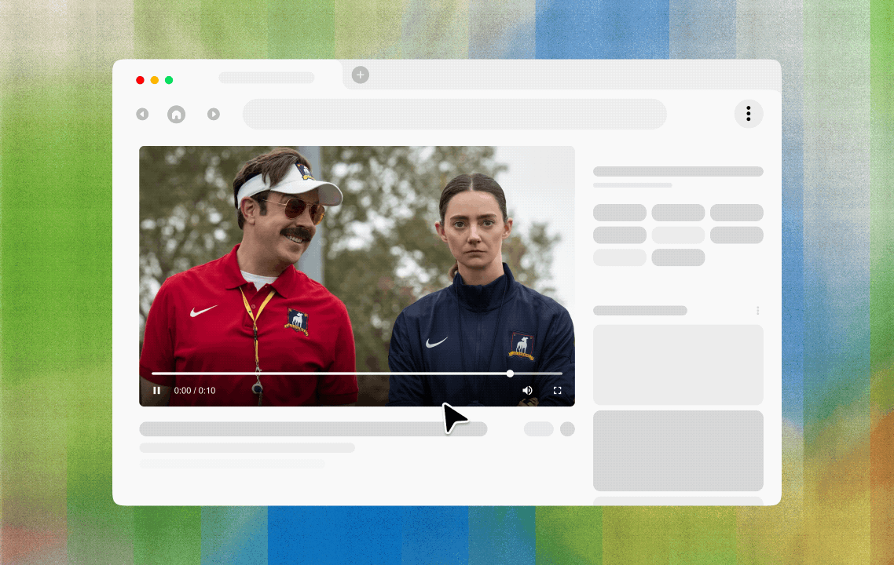
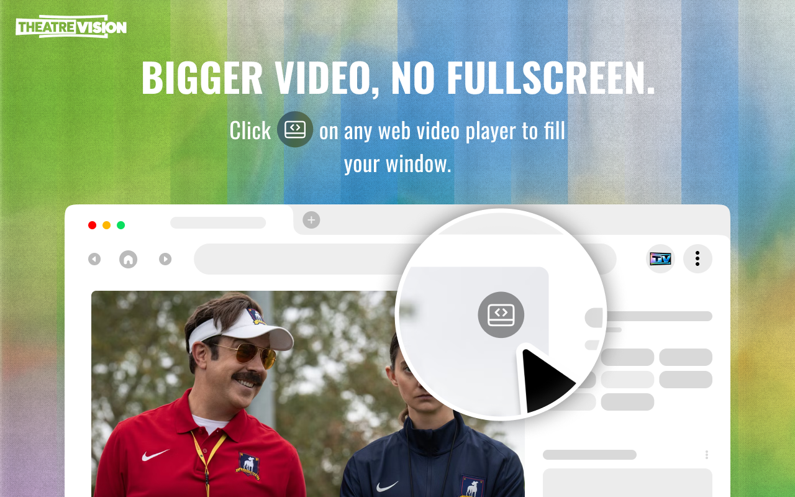
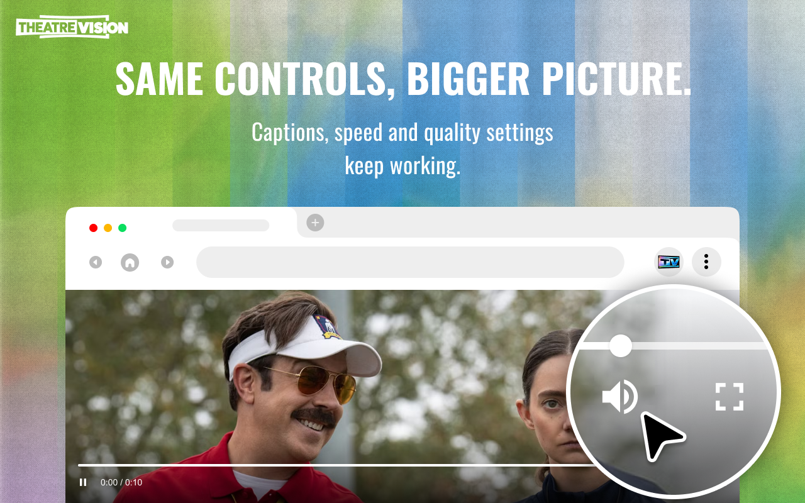
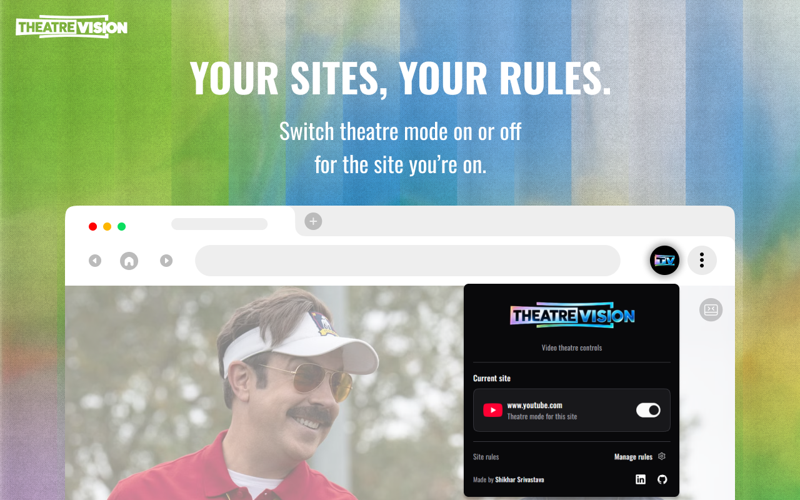
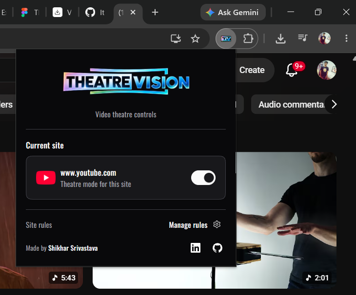

<h1>Theatre Vision</h1>

**Theatre Vision is a browser extension that makes web videos fill your browser window without going fullscreen, and keeps the site's own player controls and captions.**

  <a href="#features">Features</a> |
  <a href="#how-to-install">How To Install</a> |
  <a href="#usage">Usage</a> |
  <a href="#supported-browsers">Supported Browsers</a> |
  <a href="#privacy">Privacy</a>

⭐ If Theatre Vision is useful, a star helps others find it!

Many sites have no theatre mode, so people resize the window or zoom the page just to get a bigger player. Theatre Vision adds a button to the player: click it to enter, press <kbd>Esc</kbd> to exit.

<table>
  <tr>
    <td align="center" colspan="2">
      
    </td>
  </tr>
  <tr>
    <td align="center">
      
    </td>
    <td align="center">
      
    </td>
  </tr>
</table>

## Features

- Expands HTML5 videos and embedded players to fill the browser window, not the whole screen.
- Keeps each site's native player controls and captions.
- Allow or block sites and subdomains from the toolbar popup.
- Available in 13 languages.

Missing a site? [Open an issue](../../issues) or send a pull request.

## Supported Browsers

Theatre Vision targets current Chrome, Edge and Vivaldi: current versions. Firefox: 142 or later. Each browser uses its own sync storage. Extension settings do not sync between browsers.

## How To Install

1. Download the [latest extension ZIP](https://github.com/ItisShikhar/theatre-vision/releases/latest/download/theatre_vision_ext.zip), or clone the repository.
2. If you downloaded the ZIP, extract it.

### Chrome, Edge, and Vivaldi

1. Open the extensions page:
   - Chrome: `chrome://extensions`
   - Edge: `edge://extensions`
   - Vivaldi: `vivaldi://extensions`
2. Turn on **Developer mode**.
3. Select **Load unpacked**.
4. Choose the project folder. If you downloaded the ZIP, choose the extracted folder.

### Firefox for Desktop 142+

1. Open `about:debugging#/runtime/this-firefox`.
2. Select **This Firefox**.
3. Select **Load Temporary Add-on**.
4. Choose `manifest.json` in the project folder.

Firefox removes temporary add-ons when you close the browser.

## Usage

1. Open a site with a video.
2. Hover over the video player to show the Theatre Vision button in its top-right corner.
3. Click  to enter Theatre Vision mode.
4. To exit, click  or press <kbd>Esc</kbd>.

## Whitelist/Blacklist a Site

1. Open the site whose rule you want to change.
2. Select the Theatre Vision icon in the toolbar or extensions menu.
3. Turn Theatre mode on or off for the current site.
4. Select **Manage rules** to edit whitelisted/blacklisted domains and subdomains.
5. Changes save automatically when you add or remove a domain.

The most specific matching domain rule wins. Add `video.example.com` under allowed subdomains to override a block for `example.com`.

## Languages

Supported languages include English, Hindi, Spanish, Japanese, Korean, French, Portuguese, Bengali, Malayalam, German, Simplified Chinese, Arabic, and Russian. If your browser language is not listed, the extension uses English.

## Privacy

The extension reads the current site's hostname and page structure to find video players and apply rules. It stores blocked and allowed domains in `storage.sync`. When browser sync is enabled, your browser sends these domain rules to its account service. Theatre Vision does not send page content or rules to its developer. The popup can load the active site's favicon from that site.

Read the full [Privacy Policy](./PRIVACY_POLICY.md) for details.

### Permissions

Theatre Vision requests only what it needs to find video players and resize them.

- **Access to all websites (`<all_urls>`)**: the content script runs on every page and in embedded frames, because videos can appear on any site and are often inside iframes. It reads the page's structure on your device to find video players and to apply your allow and block rules.
- **`storage`**: saves your allow and block rules and settings in the browser's sync storage.

It does not request the tabs, history, cookies, downloads or bookmarks permissions.

If you want it to run only on specific sites, use **Manage rules** to block the rest.

## Author

Made by [Shikhar Srivastava](https://www.linkedin.com/in/itisshikhar).

[GitHub](https://github.com/ItisShikhar) ·
[LinkedIn](https://www.linkedin.com/in/itisshikhar/)

## Project Files

- Extension code and pages are in `src/`.
- Brand images are in `assets/`.
- The Oswald font and its OFL license are in `assets/fonts/`.
- Translations live in `_locales/`.

## Contributing

Read [CONTRIBUTING.md](./CONTRIBUTING.md) before you propose a change. Follow
the [Code of Conduct](./CODE_OF_CONDUCT.md) in project discussions.

## License

This project is licensed under the MIT License. See the [LICENSE](./LICENSE) file for details.

The bundled Oswald font uses the SIL Open Font License 1.1. See [OFL.txt](./assets/fonts/OFL.txt).

## Screenshots

<table>
  <tr>
    <th align="center">Toolbar popup</th>
    <th align="center">Whitelist and blacklist rules</th>
  </tr>
  <tr>
    <td align="center">
      
    </td>
    <td align="center">
      
    </td>
  </tr>
</table>

## Third-party media

The demo includes footage from _Ted Lasso_, an Apple Original series produced by Doozer Productions in association with Warner Bros. Television and Universal Television. [Source: Apple TV Press](https://www.apple.com/tv-pr/originals/ted-lasso/).
