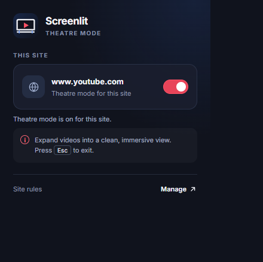
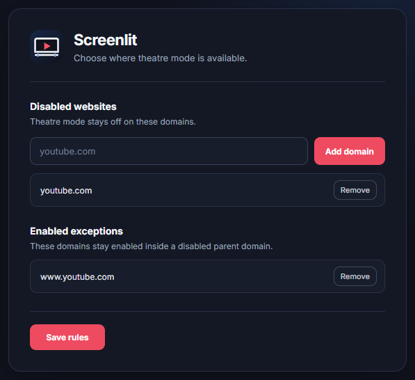

# Screenlit

Screenlit expands HTML5 and embedded videos to fill the page. It keeps native player controls and captions.

## Features

- Toggle theatre mode for the active site from the toolbar.
- Block domains or add enabled exceptions for subdomains.
- Press `Esc` to exit theatre mode.

The most specific matching domain rule wins. Add `video.example.com` under enabled exceptions to override a rule for `example.com`.

## Install

1. Open `chrome://extensions`.
2. Turn on **Developer mode**.
3. Select **Load unpacked**.
4. Choose this project folder.

## Use

1. Open a site with a video.
2. Select the Screenlit toolbar icon.
3. Turn theatre mode on or off for that site.
4. Select **Manage** to edit site rules.
5. Hover over a video and select the theatre control.

## Test

Run `node --test tests/domain-utils.test.js`.
