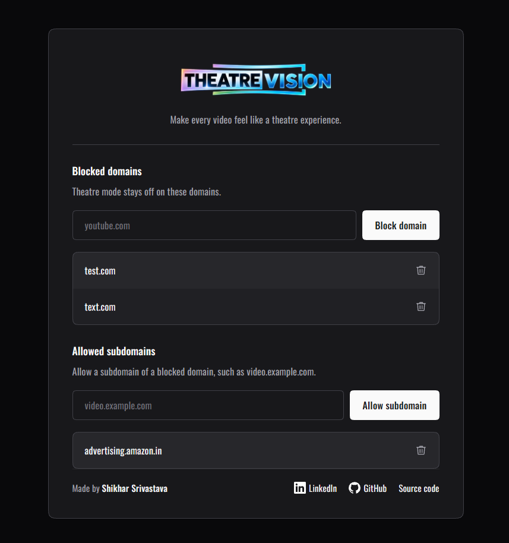
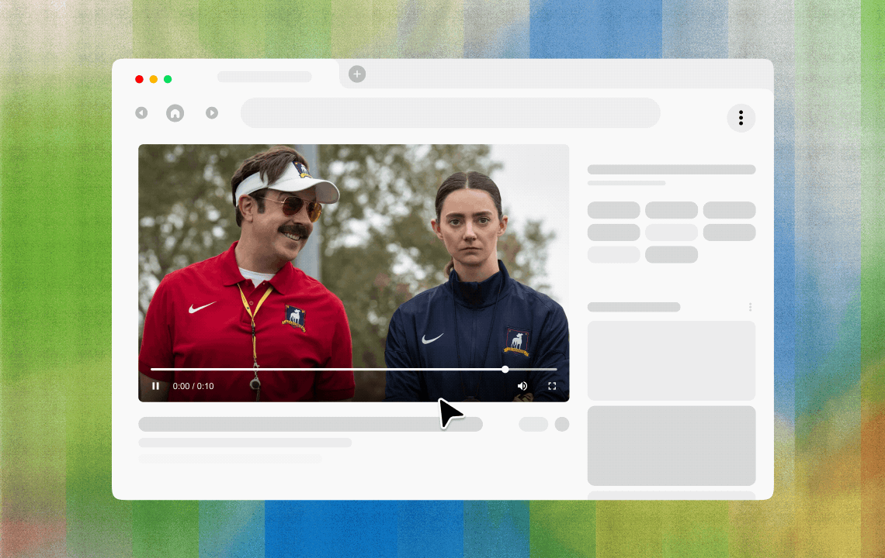

<h1>Theatre Vision</h1>

<strong>Theatre Vision expands HTML5 and embedded videos to fill the browser viewport while keeping native player controls and captions.</strong>

Many sites lack a mode that fills the browser viewport without taking over the whole screen. Users often resize the browser or zoom the page with <kbd>Ctrl</kbd>/<kbd>Cmd</kbd> + <kbd>+</kbd> to trigger responsive breakpoints.

  <a href="#how-to-install">How To Install</a> |
  <a href="#features">Features</a> |
  <a href="#supported-browsers">Supported Browsers</a> |
  <a href="#screenshots">Screenshots</a> |
  <a href="#site-rules">Site Rules</a> |
  <a href="#languages">Languages</a> |
  <a href="#contributing">Contributing</a>

⭐ Help us reach more developers and grow the community. Star this repo!

## Features

- Toggle theatre mode for the active site from the toolbar.
- Add or remove blocked domains and allowed subdomains. Changes save automatically.
- Theatre Vision has been tested on many video sites. If it does not work on a specific site, please open an issue.

## Supported Browsers

Theatre Vision targets current Chrome, Microsoft Edge, Vivaldi, and Firefox for desktop 142 or later. Each browser uses its own sync storage. Rules do not sync between browsers.

## Screenshots

## How To Install

1. Clone the repository, or download and extract its ZIP archive.

### Chrome, Edge, and Vivaldi

1. Open the extensions page:
   - Chrome: `chrome://extensions`
   - Edge: `edge://extensions`
   - Vivaldi: `vivaldi://extensions`
2. Turn on **Developer mode**.
3. Select **Load unpacked**.
4. Choose the project folder. If you downloaded the ZIP, choose the extracted folder.

### Firefox for Desktop 142+

1. Open `about:debugging#/runtime/this-firefox`.
2. Select **This Firefox**.
3. Select **Load Temporary Add-on**.
4. Choose `manifest.json` in the project folder.

Firefox removes temporary add-ons when you close the browser.

## Use

1. Open a site with a video.
2. Hover over the video player to show the Theatre Vision button in its top-right corner.
3. Click  to enter Theatre Vision mode.
4. To exit, click  or press <kbd>Esc</kbd>.

## Site Rules

1. Open the site whose rule you want to change.
2. Select the Theatre Vision icon in the toolbar or extensions menu.
3. Turn Theatre mode on or off for the current site.
4. Select **Manage rules** to edit blocked domains and allowed subdomains.
5. Changes save automatically when you add or remove a domain.

The most specific matching domain rule wins. Add `video.example.com` under allowed subdomains to override a block for `example.com`.

## Languages

The popup, site rules, and video controls use the browser language. Supported languages include English, Hindi, Spanish, Japanese, Korean, French, Portuguese, Bengali, Malayalam, German, Simplified Chinese, Arabic, and Russian.

## Privacy

The extension reads the current site's hostname and page structure to find video players and apply rules. It stores blocked and allowed domains in `storage.sync`. If browser sync is enabled, the browser can sync these rules through its account service. Theatre Vision does not send these rules to its developer.

## Author

Made by [Shikhar Srivastava](https://www.linkedin.com/in/itisshikhar).

[GitHub](https://github.com/ItisShikhar) · [Source code](https://github.com/ItisShikhar/theatre-vision)

## Project Files

- Extension code and pages are in `src/`.
- Brand images are in `assets/`.
- Chrome locale catalogs remain in `_locales/`.

## Contributing

Read [CONTRIBUTING.md](./CONTRIBUTING.md) before you propose a change. Follow
the [Code of Conduct](./CODE_OF_CONDUCT.md) in project discussions.

## License

This project is licensed under the MIT License. See the [LICENSE](./LICENSE) file for details.
